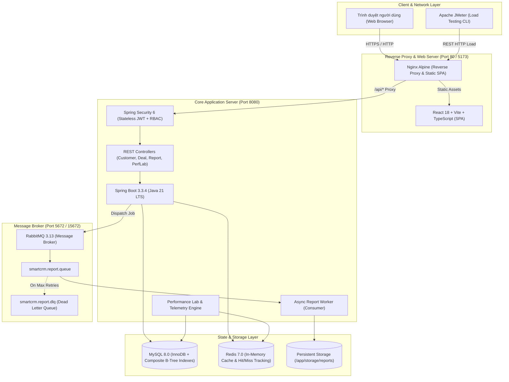

# SMARTCRM — ENTERPRISE CRM & PERFORMANCE PLATFORM
> **Đề tài kỹ thuật:** Nâng cấp và tối ưu hóa hiệu năng cho hệ thống phần mềm quản lý quan hệ khách hàng (Customer Relationship Management).

[](https://github.com/smartcrm/smartcrm/actions)
[](https://adoptium.net/)
[](https://spring.io/projects/spring-boot)
[](https://react.dev/)
[](https://www.docker.com/)
[](LICENSE)

---

## 1. Giới thiệu tổng quan

**SmartCRM** là nền tảng quản trị quan hệ khách hàng (CRM) hiện đại, được nghiên cứu và phát triển theo định hướng kiến trúc phân tán hiệu năng cao. Hệ thống được hoàn thiện qua 5 giai đoạn tiến hóa kỹ thuật:

- **Phase 1 (Product Foundation):** Kiến trúc 3 tầng chuẩn mực, xác thực phân quyền Role-Based Access Control (RBAC), quản lý khách hàng, giao dịch (Deal Pipeline Kanban), quản trị tài khoản và hệ thống ghi vết kiểm toán (Audit Trail).
- **Phase 2 (System-Wide Performance Optimization):** Tối ưu hóa toàn diện Database và Caching. Triệt tiêu hoàn toàn vấn đề N+1 Query bằng JPA `@EntityGraph`, đẩy điều kiện tính toán xuống MySQL qua Projection & Database Aggregations, và triển khai chiến lược Multi-layer Redis Caching giảm độ trễ Dashboard xuống dưới 1ms.
- **Phase 3 (Asynchronous Reporting):** Xây dựng hệ thống xuất báo cáo nền quy mô lớn (CSV / XLSX) tách biệt qua Message Broker **RabbitMQ**, cơ chế chống nghẽn luồng (Dead Letter Queue - DLQ), phân quyền tải file chống IDOR, và phục hồi tác vụ khi Worker gặp sự cố.
- **Phase 4 (Performance Lab & Observability):** Xây dựng phòng thí nghiệm đo lường hiệu năng độc lập, thu thập telemetry thời gian thực (CPU, RAM, HikariCP, Redis Cache Hit Ratio), so sánh trực quan Baseline vs Optimized có kiểm chứng, và bộ kịch bản kiểm thử tải có thể tái lập với **Apache JMeter**.
- **Phase 5 (Production Readiness & Deployment):** Kiểm toán bảo mật toàn diện (OWASP Top 10, IDOR, Path Traversal, XSS, CSRF, Secret Leaks), đóng gói container hóa Docker đa tầng (Multi-stage Build), thiết lập quy trình CI/CD tự động, và các kịch bản sao lưu/khôi phục dữ liệu định kỳ.

---

## 2. Sơ đồ kiến trúc hệ thống



---

## 3. Yêu cầu môi trường (Prerequisites)

### A. Triển khai bằng Docker (Khuyến nghị)
- **Docker Engine:** 24.0+
- **Docker Compose:** v2.20+
- **Tài nguyên tối thiểu:** 2 CPU Cores, 4GB RAM, 10GB ổ cứng trống.

### B. Triển khai Local Development (Không dùng Docker)
- **Java Development Kit (JDK):** OpenJDK / Eclipse Temurin 21 LTS
- **Node.js:** v20.x LTS trở lên & npm v10+
- **MySQL Server:** 8.0+
- **Redis Server:** 7.0+
- **RabbitMQ Server:** 3.13+ (bật plugin `rabbitmq_management`)
- **Apache JMeter:** 5.6+ (tùy chọn để chạy tải ngoài)

---

## 4. Hướng dẫn khởi chạy nhanh

### Cách 1: Khởi động trọn gói bằng Docker Compose (1 lệnh)

1. **Clone repository và chuẩn bị file cấu hình:**
   ```bash
   cd SmartCRM
   cp .env.example .env
   ```
2. **Khởi chạy toàn bộ hệ thống:**
   ```bash
   docker compose up -d --build
   ```
3. **Kiểm tra trạng thái các container:**
   ```bash
   docker compose ps
   ```
   *Tất cả 5 container (`smartcrm-mysql`, `smartcrm-redis`, `smartcrm-rabbitmq`, `smartcrm-backend`, `smartcrm-frontend`) phải ở trạng thái `healthy` hoặc `Up`.*
4. **Truy cập ứng dụng:**
   - **Giao diện người dùng Web:** [http://localhost:80](http://localhost:80) hoặc [http://localhost:5173](http://localhost:5173)
   - **Swagger REST API Docs:** [http://localhost:8080/swagger-ui.html](http://localhost:8080/swagger-ui.html)
   - **RabbitMQ Management Dashboard:** [http://localhost:15672](http://localhost:15672) (User: `smartcrm`, Pass: `smartcrm_password`)

---

### Cách 2: Khởi động môi trường phát triển (Standalone Dev)

#### Bước 1: Khởi động Backend (Spring Boot)
```bash
cd backend
# Chạy với profile mặc định (H2 In-Memory DB tự sinh dữ liệu và Flyway migrations)
./mvnw clean spring-boot:run
# Hoặc trên Windows:
.\mvnw.cmd spring-boot:run
```
*Backend khởi động tại cổng `8080`.*

#### Bước 2: Khởi động Frontend (React + Vite)
```bash
cd frontend
npm install
npm run dev
```
*Frontend chạy tại cổng `http://localhost:5173` với tính năng Hot Module Replacement (HMR).*

---

## 5. Tài khoản Demo & Hướng dẫn bảo mật tài khoản

Hệ thống được khởi tạo sẵn các tài khoản demo qua Flyway `V2__seed_demo_data.sql`. Mật khẩu được băm một chiều an toàn bằng thuật toán **BCrypt**:

| Tên đăng nhập | Email | Mật khẩu mặc định | Vai trò (Roles) | Quyền hạn chính |
| :--- | :--- | :--- | :--- | :--- |
| `admin` | `admin@smartcrm.dev` | `Admin@123` | `ROLE_ADMIN`, `ROLE_MANAGER` | Toàn quyền hệ thống, quản lý thành viên, kiểm toán, chạy Benchmark Lab. |
| `manager` | `manager@smartcrm.dev` | `Manager@123` | `ROLE_MANAGER` | Quản trị phòng ban, xem toàn bộ cơ hội bán hàng, phân tích báo cáo doanh thu. |
| `sales` | `sales@smartcrm.dev` | `Sales@123` | `ROLE_SALES` | Nhân viên kinh doanh, quản lý khách hàng và deal được phân công, tạo báo cáo cá nhân. |

> **Cảnh báo bảo mật Production:**  
> Trước khi đưa hệ thống ra môi trường Internet công cộng, Quản trị viên bắt buộc phải đổi mật khẩu toàn bộ tài khoản demo hoặc vô hiệu hóa chúng, đồng thời tạo tài khoản quản trị mới với mật khẩu tối thiểu 16 ký tự.

---

## 6. Danh mục RESTful API & Ma trận phân quyền (RBAC)

Tài liệu Swagger UI tương tác trực tiếp tại: `http://localhost:8080/swagger-ui.html`

| Nhóm chức năng | Endpoint | Phương thức | Quyền hạn tối thiểu | Mô tả |
| :--- | :--- | :---: | :---: | :--- |
| **Auth** | `/api/v1/auth/login` | POST | Public | Đăng nhập cấp phát JWT Token (12h). |
| | `/api/v1/auth/me` | GET | Authenticated | Lấy thông tin tài khoản phiên đăng nhập. |
| | `/api/v1/auth/change-password` | POST | Authenticated | Đổi mật khẩu tài khoản hiện tại. |
| **Dashboard** | `/api/v1/dashboard/metrics` | GET | Authenticated | Lấy dữ liệu thống kê tổng hợp (Redis Cache Hit < 1ms). |
| **Customers** | `/api/v1/customers` | GET | Authenticated | Danh sách phân trang khách hàng (EntityGraph JOIN). |
| | `/api/v1/customers/{id}` | GET | Authenticated | Chi tiết thông tin khách hàng. |
| | `/api/v1/customers` | POST | `ROLE_SALES` | Thêm mới khách hàng tiềm năng. |
| | `/api/v1/customers/{id}` | PUT | `ROLE_SALES` | Cập nhật thông tin khách hàng. |
| | `/api/v1/customers/{id}` | DELETE | `ROLE_ADMIN` | Xóa khách hàng khỏi cơ sở dữ liệu. |
| **Deals** | `/api/v1/deals/kanban` | GET | Authenticated | Lấy dữ liệu Kanban đường ống bán hàng (DB Aggregation). |
| | `/api/v1/deals/{id}/stage` | PATCH | `ROLE_SALES` | Chuyển đổi giai đoạn và ghi vết lịch sử. |
| **Reports** | `/api/v1/reports` | POST | Authenticated | Tiếp nhận yêu cầu xuất báo cáo nền (HTTP 202 ACCEPTED). |
| | `/api/v1/reports/{jobUuid}` | GET | Authenticated | Thăm dò tiến độ xử lý báo cáo (QUEUED/RUNNING/COMPLETED). |
| | `/api/v1/reports/{jobUuid}/download`| GET | Authenticated (Chính chủ/Admin)| Tải xuống file báo cáo (CSV/Excel) chống IDOR & Path Traversal.|
| **Perf Lab** | `/api/v1/performance/metrics` | GET | `ROLE_ADMIN`, `ROLE_MANAGER` | Đọc thông số telemetry thời gian thực (CPU, RAM, Cache, HikariCP).|
| | `/api/v1/performance/benchmarks`| POST | `ROLE_ADMIN` | Thực thi kịch bản đo kiểm hiệu năng với VUs tùy chọn. |
| | `/api/v1/performance/comparisons`| GET | `ROLE_ADMIN`, `ROLE_MANAGER`| Bảng so sánh % cải thiện Trước/Sau tối ưu. |
| **Users** | `/api/v1/users` | GET, POST | `ROLE_ADMIN`, `ROLE_MANAGER` | Quản lý thành viên, kích hoạt/khóa tài khoản. |
| **Audit** | `/api/v1/audit-logs` | GET | `ROLE_ADMIN`, `ROLE_MANAGER` | Tra cứu nhật ký kiểm toán hệ thống. |

---

## 7. Hướng dẫn đo kiểm hiệu năng (Performance Benchmark)

### Cách 1: Đo kiểm trực tiếp trên Giao diện Web (Performance Lab)
1. Đăng nhập tài khoản `admin` / `Admin@123`.
2. Truy cập tab **"Performance Lab"** trên thanh menu điều hướng.
3. Lựa chọn kịch bản cần đo (ví dụ: *Đọc Dashboard có Cache (Redis Hit)* hoặc *Phân trang khách hàng*).
4. Thiết lập số lượng Virtual Users (1–20 VUs) và số lượt lặp (10–100 lần).
5. Tích chọn xác nhận điều kiện an toàn nội bộ và bấm **"Bắt đầu đo kiểm (Execute Benchmark)"**.
6. Hệ thống sẽ tự động tính toán p50, p95, p99, Throughput và tính % cải thiện thực tế so với Baseline.

### Cách 2: Chạy kiểm thử tải Apache JMeter độc lập
Bộ công cụ kiểm thử tải chuyên dụng được đặt tại thư mục `jmeter/`:
```bash
# Trên Windows
cd jmeter
run_jmeter_test.bat

# Trên Linux / macOS
cd jmeter
chmod +x run_jmeter_test.sh
./run_jmeter_test.sh localhost 8080 15 30
```
Sau khi hoàn thành, mở báo cáo HTML tại `jmeter/results/report/index.html`.

---

## 8. Quy trình sao lưu & khôi phục dữ liệu (Backup & Restore)

Hệ thống cung cấp sẵn các script tự động hóa sao lưu và khôi phục trong thư mục `scripts/`:

### A. Sao lưu cơ sở dữ liệu (Backup)
```bash
# Trên Linux / macOS (Tự động nén gzip)
./scripts/backup_database.sh ./backups

# Trên Windows
scripts\backup_database.bat
```
*Tệp sao lưu sẽ được xuất dưới định dạng `smartcrm_backup_YYYYMMDD_HHMMSS.sql.gz` với tùy chọn `--single-transaction --quick` đảm bảo tính toàn vẹn dữ liệu mà không khóa bảng.*

### B. Khôi phục cơ sở dữ liệu (Restore)
```bash
# Trên Linux / macOS
./scripts/restore_database.sh ./backups/smartcrm_backup_20261015_230000.sql.gz

# Trên Windows
scripts\restore_database.bat .\backups\smartcrm_backup_20261015_230000.sql
```

---

## 9. Quy trình Triển khai & Rollback Production

### A. Triển khai chuẩn (Production Deployment)
1. Cấu hình các biến bí mật trong file `.env` (xem chi tiết trong `.env.example`).
2. Kích hoạt profile production:
   ```bash
   export SPRING_PROFILES_ACTIVE=prod
   docker compose -f docker-compose.yml up -d --build
   ```
3. Kiểm tra tính sẵn sàng thông qua Healthcheck Probes:
   ```bash
   curl -f http://localhost:8080/actuator/health
   ```
   *Yêu cầu kết quả: `{"status":"UP", ...}`.*

### B. Chiến lược Rollback an toàn khi có sự cố
1. **Rollback Container Image:**
   ```bash
   docker compose stop backend frontend
   # Khởi động lại phiên bản image trước đó đã được tag
   docker tag smartcrm-backend:previous smartcrm-backend:latest
   docker compose up -d backend frontend
   ```
2. **Rollback Cơ sở dữ liệu (nếu migration thất bại):**
   - Flyway được cấu hình `clean-disabled: true` trong production để ngăn chặn tai nạn xóa dữ liệu.
   - Sử dụng file backup trước khi deploy để phục hồi:
     `./scripts/restore_database.sh ./backups/pre_deploy_backup.sql.gz`

---

## 10. Bảng kiểm tra an toàn & Các hạn chế đã biết

### Rào cản an toàn đã kích hoạt (Security Checklist):
-  **Stateless JWT Authentication:** Khóa bí mật JWT tối thiểu 256-bit, mã hóa BCrypt cấp phát động.
-  **RBAC Server-side Enforcement:** Kiểm tra `@PreAuthorize` trên toàn bộ controller và service nhạy cảm.
-  **Chống SQL Injection:** 100% truy vấn dùng JPA Specification và Parameterized Named Queries.
-  **Chống IDOR & Path Traversal:** Xác thực quyền sở hữu báo cáo và kiểm tra `canonicalPath` đối chiếu với thư mục lưu trữ `/app/storage/reports`.
-  **Bảo vệ Performance Lab:** Giới hạn tải cứng (Max 20 VUs, Max 500 requests), timeout 30 giây, chống SSRF (không cho phép nhập URL bên ngoài).
-  **Production Headers & CORS:** Thiết lập `X-Frame-Options: DENY`, `X-Content-Type-Options: nosniff`, CORS whitelist rõ ràng.

### Các hạn chế đã biết (Known Limitations):
1. **Single-Node Worker:** Background worker hiện đang chạy cùng process với backend Spring Boot. Khi lượng tác vụ báo cáo vượt 100 tác vụ/giây, khuyến nghị tách worker thành standalone deployment.
2. **Local Storage cho Báo cáo:** File báo cáo được lưu trên persistent Docker Volume cục bộ. Trong môi trường Kubernetes đa cụm (Multi-node cluster), nên chuyển sang sử dụng S3-compatible storage (MinIO / AWS S3 / Google Cloud Storage).
3. **Phụ thuộc Network RTT khi Benchmark:** Kết quả đo kiểm tại môi trường local loại trừ độ trễ đường truyền Internet thực tế. Khi triển khai trên cloud public, cần cộng thêm trung bình 15–40ms latency mạng.
